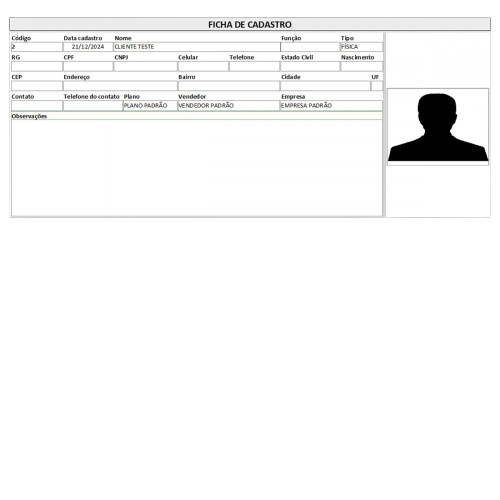

# Sistema de Cadastro em Python

Projeto desenvolvido em Python com o objetivo de praticar lógica de programação.

## Funcionalidades
- Cadastrar pessoas
- Listar pessoas cadastradas
- Menu interativo no terminal

## Tecnologias utilizadas
- Python 3

## Conceitos aplicados
- Estruturas condicionais
- Laços de repetição
- Funções
- Listas e dicionários

## Objetivo
Projeto criado para fins educacionais, como parte da minha formação em Engenharia de Software.
